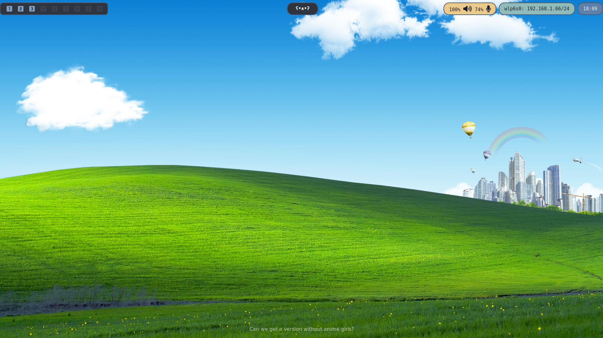
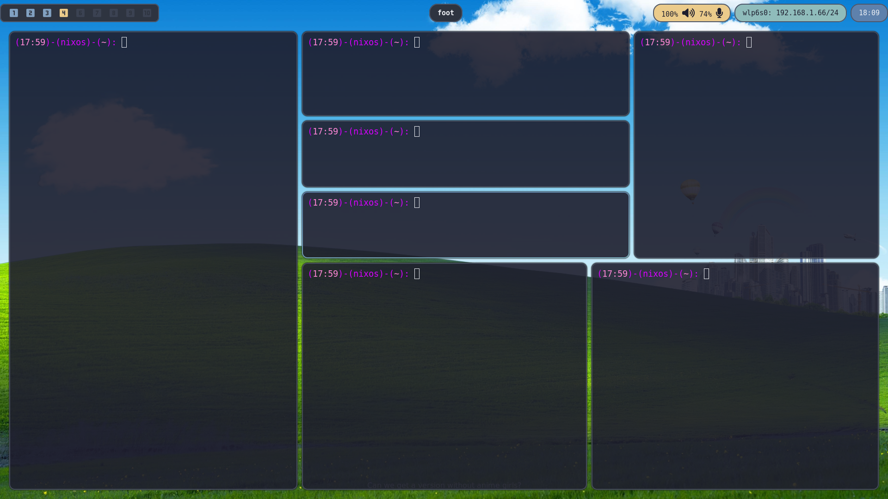

# NixOS Rice

This is my NixOS rice, showcasing a customized and aesthetic Hyprland setup for a lightweight and visually appealing Linux desktop environment.

## Screenshot





## NixOS configuration

The `nixos_config/` directory contains the system configuration copied from
`/etc/nixos`. Desktop settings copied from `~/.config` are under `config/`.

## Configuration scripts

Run these commands from the repository root:

```bash
# Preview changes from the system into the repository
./Scripts/backup_configs.sh --dry-run

# Back up /etc/nixos and ~/.config into this repository
./Scripts/backup_configs.sh

# Preview installing the repository configuration
./Scripts/install_config.sh --dry-run

# Install nixos_config into /etc/nixos and config into ~/.config
./Scripts/install_config.sh
```

The backup and install scripts use `rsync`. The NixOS configuration sync uses
`sudo` because `/etc/nixos` is system-owned. After installing NixOS changes,
apply them with:

```bash
sudo nixos-rebuild switch --flake ./nixos_config#BonDia
```

> Note: The screenshots include local network information.