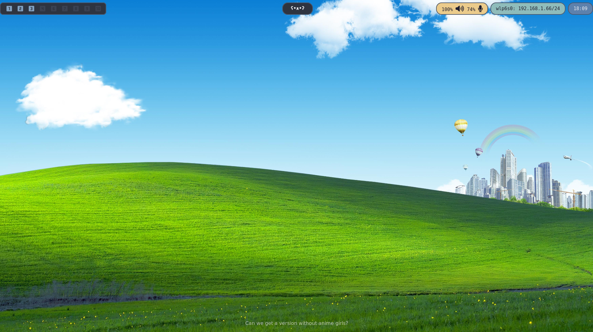
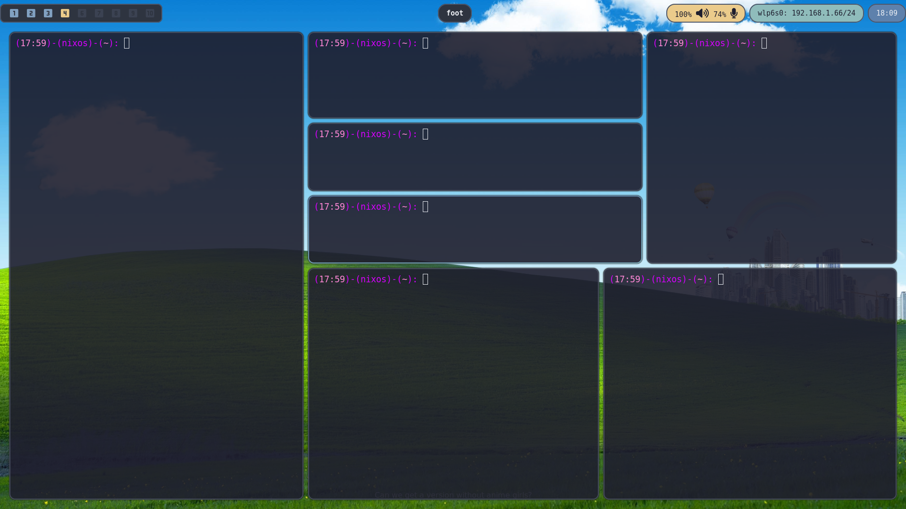

# NixOS Rice

A personal NixOS configuration for a lightweight Hyprland desktop. It includes
system modules, Home Manager settings, and a small collection of application
configurations managed from one flake.




## What's included

- Hyprland and desktop services
- Home Manager configuration for the configured user
- Quickshell bar with system information
- Configurations for Hyprland, Foot, Tofi, Walker, and Fastfetch
- Modular NixOS settings under `nix_config/nixos-config-parts/`

The repository layout is:

```text
nix_config/
├── flake.nix
├── configuration.nix
├── home.nix
├── nixos-config-parts/
└── app-configs/
```

Files under `nix_config/app-configs/` are installed into `~/.config/` by Home
Manager through `xdg.configFile`.

## Requirements

- NixOS with flakes enabled
- An `x86_64-linux` system
- Git
- A working graphical session with Hyprland-compatible hardware

## Check the configuration

Run these commands from the repository root:

```bash
nix flake check ./nix_config --no-build --show-trace
nix build ./nix_config#nixosConfigurations.BonDia.config.system.build.toplevel \
  --dry-run --show-trace
```

## Install or update

Review the configuration before applying it. Then switch to the new system:

```bash
sudo nixos-rebuild switch --flake ./nix_config#BonDia
```

The `BonDia` output is the example machine configuration defined in
`nix_config/flake.nix`.

## Adapting it to another machine

The flake keeps reusable desktop modules separate from per-machine settings.
To add another PC:

1. Copy the `BonDia` entry in `nix_config/flake.nix` and give it a new output
   name, host name, and username.
2. Save the target machine's generated hardware file as a unique file such as
   `nix_config/hardware-<name>.nix`, then reference that file in its
   `hostModules` list.
3. Add or remove `nixos-config-parts/nvidia.nix` and `map-disks.nix` in that
   host's `hostModules` list as needed.
4. Set `videoDriver` to `null` for non-NVIDIA graphics, or to the appropriate
   X11 driver name when required.
5. Review the boot settings, enabled services, and disk UUIDs before applying.

Shared user paths use the active user's home directory, but hardware
configuration and disk mappings must never be reused blindly.

## Notes

The screenshots may contain local network information. The configuration is a
personal rice rather than a universal hardware profile, so treat it as a
starting point and audit it before applying it to another system.